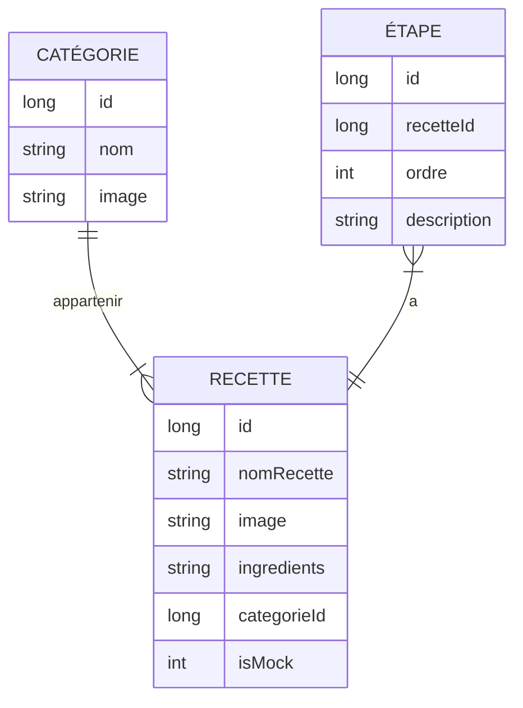

# TP2 - [Cuisto][git-link]

## Les Moineaux
Le mode de communication de l'équipe est un canal Teams
Cette équipe est composée de trois développeurs :
- Kelly Henri Clovis
- Kristopher Solhtalab
- Émile Girard

Responsable des communications: [Émile Girard][email]

## Présentation de l'application
**Cuisto**, à travers son interface intuitive, vous permet de consulter et gérer vos recettes. Son système de stockage local permet de d'enregistrer une grande quantité d'information sans encombrer votre espace de création. Vos recettes sont catégorisées et accessibles au bout de vos doigts à n'importe quel moment.

 C'est l'outil parfait pour conserver vos tradtitions culinaires de manière sûre et pratique!

## Fonctionnalitées
Une analyse détaillée des fonctionnalitées et de l'architecture de l'application
est disponible dans le fichier `analyse.md`
| Responsable | Description |
| :--- | :--- |
| Émile       | Ajouter / Modifier/Supprimer une recette|
| Émile       | Stockage dans une base de donnée locale SQL|
| Kelly       | Conception maquette |
| Kelly       | Introduction |
| Kelly       | Remplissage de la base de donnee + Compression images |
| Kelly       | Accueil + Bloc de categorie 'Bas de page' dynamique |
| Kelly       | Toutes les recettes |
| Kelly       | Recette par categorie |
| Kristopher  | Barre de recherche, I18n|
| Kristopher  | Afficher une recette en détail|

[//]: # (Links)
[email]: (mailto:1649962@crosemont.qc.ca)
[git-link]:(https://git.dti.crosemont.quebec/egirard/tp2-cahier-de-recettes)

## Diagramme entité-relation

